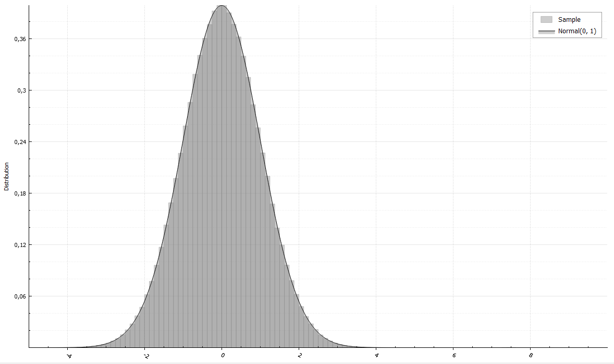
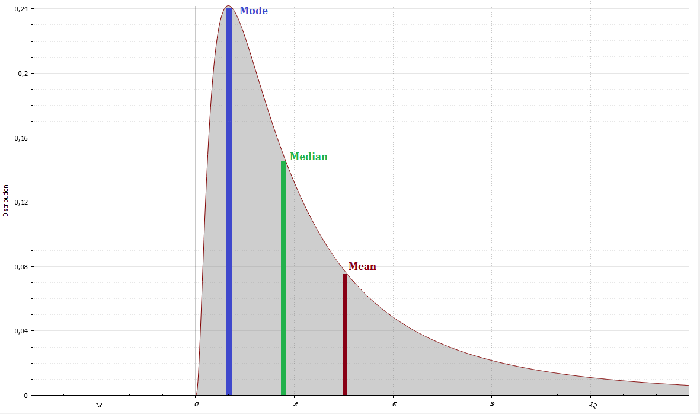
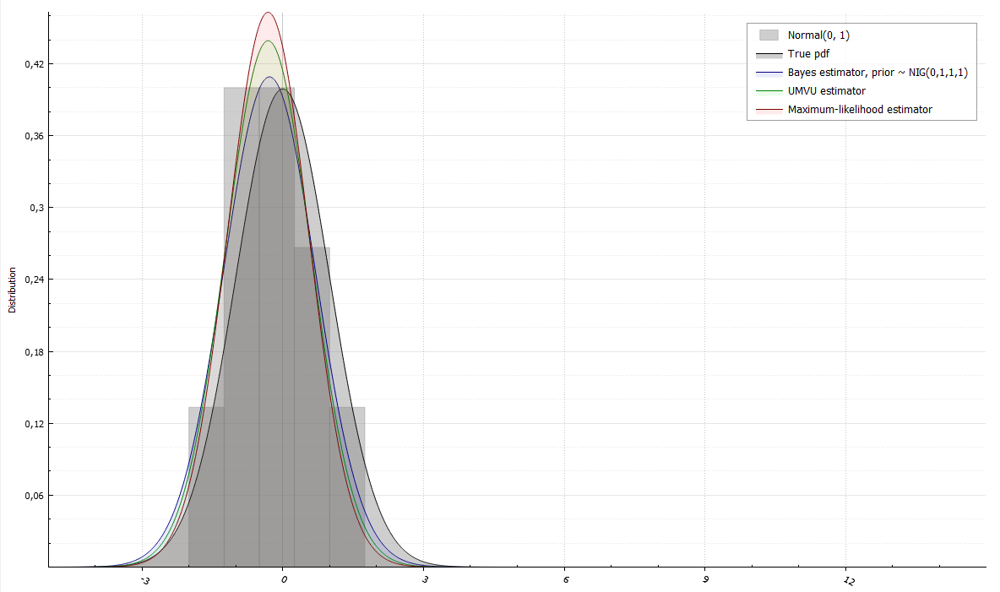

# RandLib

[](https://github.com/astralord/RandLib/actions/workflows/ci.yml)
[](https://codecov.io/gh/astralord/RandLib)
[](https://www.codefactor.io/repository/github/astralord/randlib/overview/master)

With RandLib one can easily work with probability distributions. One of the major advantages of this library (apart from being free and open-source) is that it doesn't require any additional packages. All you need is C++17 compiler support.

Version 1.2 is a stabilization release: it fixes many correctness bugs and checks every
distribution against high-precision reference values. Note that **sampled values differ from
1.1 for the same seed**. See [CHANGELOG.md](CHANGELOG.md) and the
[modernization plan](docs/MODERNIZATION_PLAN.md).

## Building

RandLib builds with CMake 3.21 or newer:

```sh
cmake -S . -B build -DCMAKE_BUILD_TYPE=Release
cmake --build build
ctest --test-dir build --label-regex unit      # fast unit tests
ctest --test-dir build --label-regex statistical
cmake --install build --prefix /usr/local
```

and is consumed with

```cmake
find_package(RandLib 1.2 REQUIRED)
target_link_libraries(my_target PRIVATE RandLib::RandLib)
```

Options: `BUILD_SHARED_LIBS` (static by default), `RANDLIB_BUILD_TESTS`,
`RANDLIB_WARNINGS_AS_ERRORS`, `RANDLIB_GENERATOR` (`JKISS`, `JLKISS64` or `PCG32`) and
`RANDLIB_PORTABLE_SPECIAL_FUNCTIONS`. The presets in `CMakePresets.json` cover development,
release and sanitizer builds (`cmake --preset dev`).

## Examples

What can be done via RandLib? Here are some useful examples:

* Fast sampling. For instance, generate million variates from standard normal distribution:
```c++
NormalRand X(0, 1);
X.Reseed(42); // reproducible stream
std::vector<double> data(1e6);
X.Sample(data);
```


* Calculate moments and other properties:
```c++
LogNormalRand X(1, 1);
std::cout << " Mean = " << X.Mean()
          << " and Variance = " << X.Variance()
          << "\n Median = " << X.Median()
          << " and Mode = " << X.Mode()
          << "\n Skewness = " << X.Skewness()
          << " and Excess kurtosis = " << X.ExcessKurtosis();
```

```
Mean = 4.48169 and Variance = 34.5126
Median = 2.71828 and Mode = 1
Skewness = 6.18488 and Excess Kurtosis = 110.936
```
* Fitting parameters using different estimators:
```c++
using std::cout;

NormalRand X(0, 1);
std::vector<double> data(10);
X.Sample(data);
cout << "True distribution: " << X.Name() << "\n";
cout << "Sample: ";
for (double var : data)
    cout << var << "  ";
cout << "\n";

/// Bayesian estimation
NormalInverseGammaRand prior(0, 1, 1, 1);
NormalInverseGammaRand posterior = X.FitBayes(data, prior);
cout << "Bayesian estimator: " << X.Name() << "\n";
cout << "(Posterior distribution: " << posterior.Name() << ")\n";

/// Uniformly minimum variance unbiased estimator
X.Fit(data, true);
cout << "UMVU estimator: " << X.Name() << "\n";

/// Maximum-likelihood estimator
X.Fit(data);
cout << "Maximum-likelihood estimator: " << X.Name() << "\n";
```

```
True distribution: Normal(0, 1)
Sample: -0.328154  0.709122  -0.607214  1.11472  -1.23726  -0.123584  0.59374  -1.20573  -0.397376  -1.63173
Bayesian estimator: Normal(-0.283042, 0.951348)
(Posterior distribution: Normal-Inverse-Gamma(-0.283042, 11, 6, 4.75674))
UMVU estimator: Normal(-0.311347, 0.82504)
Maximum-likelihood estimator: Normal(-0.311347, 0.742536)
```

For documentation look up [here](documentation/document.pdf)
